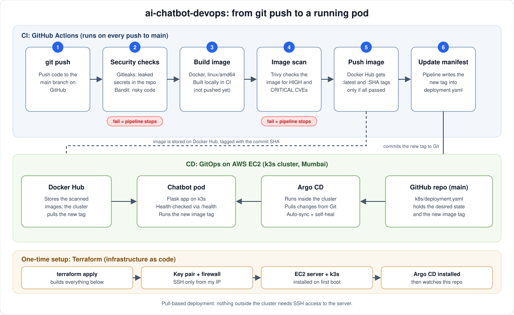

# ai-chatbot-devops



A small Flask chatbot API, used as a vehicle to build and document a complete **DevSecOps delivery pipeline** on AWS: infrastructure as code, security scanning in CI, and GitOps deployment to Kubernetes.

The app is deliberately simple. The point of the project is everything around it.

## How it works

1. **Security checks first.** Gitleaks looks for leaked secrets and Bandit scans the Python code. If either fails, nothing else runs.
2. **Build and scan.** The image is built locally in the pipeline and scanned by Trivy for HIGH and CRITICAL vulnerabilities. A vulnerable image is never pushed.
3. **Publish.** Only an image that passed every check goes to Docker Hub, tagged `latest` and with the commit SHA.
4. **GitOps.** The pipeline writes the new SHA tag into `k8s/deployment.yaml`. Argo CD, running inside the cluster, sees the change in Git and rolls it out. No SSH access from CI to the server is needed.

## Stack

| Area | Tools |
|---|---|
| App | Python, Flask, Ollama API client |
| AI model | Ollama running in the cluster (llama3.2:1b, CPU only) |
| Container | Docker (linux/amd64) |
| Infrastructure as code | Terraform (AWS provider) |
| Cloud | AWS EC2 (Mumbai, ap-south-1), k3s |
| CI | GitHub Actions |
| Security scanning | Gitleaks, Bandit, Trivy |
| Deployment | Argo CD (GitOps), Kubernetes manifests |

## Repository layout

```
app/          Flask application and requirements
k8s/          App and Ollama deployments, Service, ConfigMap (watched by Argo CD)
terraform/    EC2 server, key pair and security group
argocd/       Argo CD Application definition
docs/         Pipeline diagram
.github/      CI pipeline
Dockerfile    Container image
```

## API

| Endpoint | Purpose |
|---|---|
| `GET /` | Basic status message |
| `GET /health` | Health check, used by Kubernetes readiness and liveness probes |
| `POST /chat` | Sends `{"message": "..."}` to an Ollama model and returns the reply |

## Run it locally

```bash
docker build -t ai-chatbot .
docker run -p 5000:5000 ai-chatbot
curl http://localhost:5000/health
```

## Deploy it from scratch

1. Create an SSH key: `ssh-keygen -t ed25519 -f ~/.ssh/ai-chatbot-key -N ""`
2. In `terraform/`, create `terraform.tfvars` containing `my_ip = "<your public IP>/32"`
3. Run `terraform init` and `terraform apply`. This creates the key pair, a security group (SSH from your IP only, HTTP open) and an EC2 instance that installs k3s on first boot.
4. SSH to the server and install Argo CD (pinned to v3.4.10), then apply `argocd/application.yaml`. Argo CD takes over from there.

## Security decisions

- **SSH is restricted** to a single IP address. CI never needs SSH access, because deployment is pull-based through Argo CD.
- **Terraform state, `.tfvars` and key files are git-ignored.** The private key never leaves my machine; AWS only receives the public half.
- **Scan failures stop the pipeline.** Secrets, code and image are all checked before anything is published.
- **The Trivy action is pinned to a commit SHA**, not a version tag (see below).

## Things that went wrong, and what I learned

- **Bandit flagged `host="0.0.0.0"`.** Inside a container the app must listen on all interfaces, so I reviewed it, documented the reason in a `# nosec` comment, and kept the scan strict for everything else.
- **The Trivy action tag I used no longer existed.** In March 2026 attackers hijacked most of the trivy-action version tags to steal credentials from pipelines. The failure happened before any code ran, so nothing was exposed. I pinned the action to the full commit SHA of a version listed as safe, because tags can be moved and commit hashes cannot.
- **Trivy found two HIGH vulnerabilities** in `setuptools` and `wheel`, packaging tools bundled with the Python base image that the app never uses at runtime. Instead of just upgrading them, I removed them from the final image, which fixed the findings and shrank the attack surface.
- **My new AWS account was on the free plan**, which rejected the `t3.medium` instance type. I queried the allowed types and chose `m7i-flex.large` (x86, 8 GB) to keep the same CPU architecture as the image.
- **Ollama crashed with a segmentation fault on AWS.** The model loaded fine and memory was not the problem, but the runner died on the first request. The logs pointed at a CPU-specific code path, and my instance (m7i family) uses a Sapphire Rapids CPU. I found a matching upstream Ollama issue, proved the theory by disabling that one library in the running pod, and then made the workaround permanent in the Kubernetes manifest so it survives restarts and stays reproducible through Git. The cost is slower inference on CPU.

## In progress

- Prometheus and Grafana monitoring on the new cluster
- Remote Terraform state (S3 with locking)
- Pinning the remaining GitHub Actions to commit SHAs
